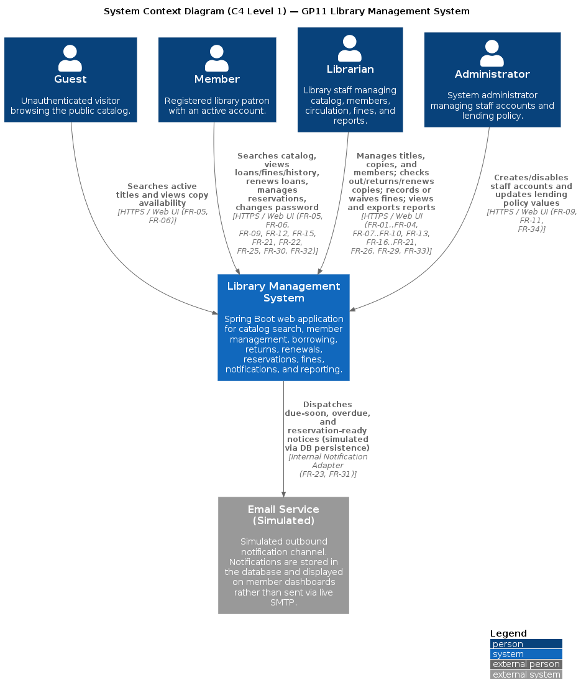
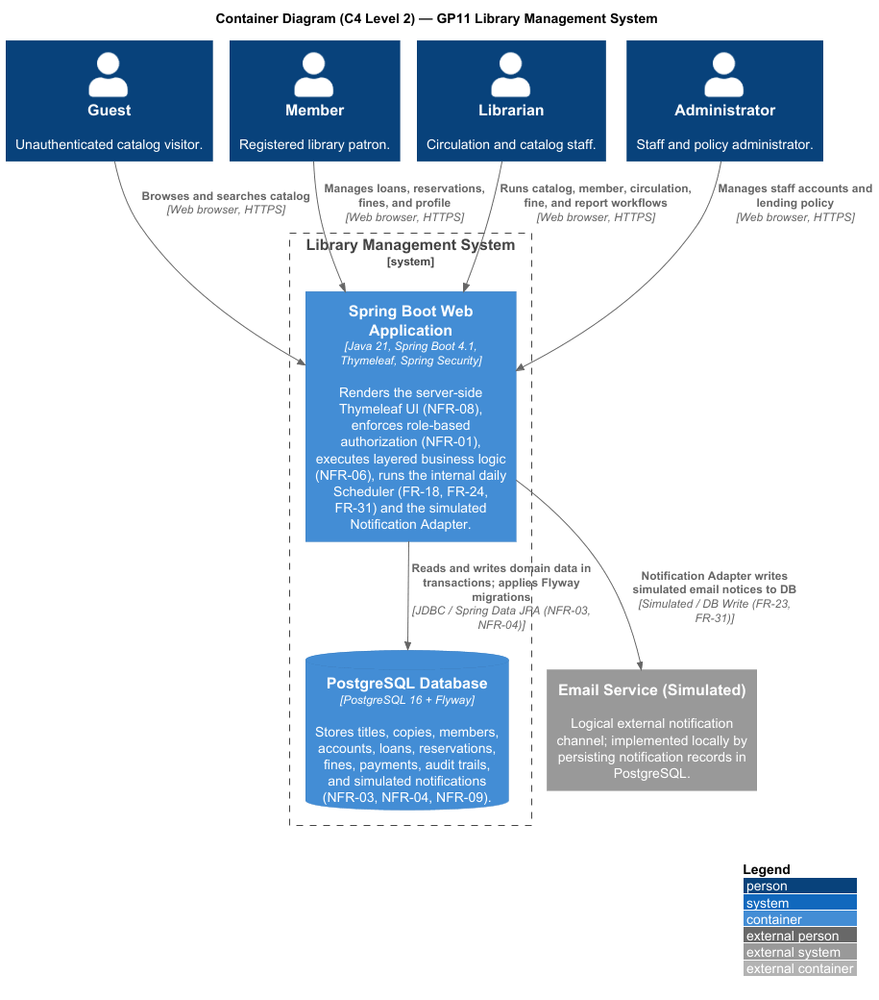
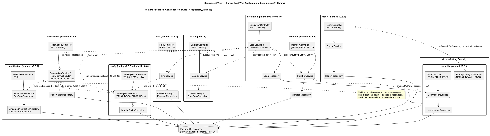

# Architecture — GP11 Library Management System

This document describes the architecture of the Library Management System across C4 Level 1 (System
Context), C4 Level 2 (Containers), an application Component View, and the Docker Compose Deployment
View. Technology choices referenced below are justified in the decisions log in
[§5–6](#5-technology-decisions).

---

## 1. System Context (C4 Level 1)

The **Library Management System** is a single web application serving four human actor roles defined
in `docs/requirements.md`:

- **Guest** — browses and searches active titles and views copy availability (`FR-05`, `FR-06`).
- **Member** — logs in (`FR-09`) to view active loans, borrowing history, fines, and notifications,
  renew eligible loans, and manage title reservations (`FR-12`, `FR-15`, `FR-21`, `FR-22`, `FR-25`,
  `FR-30`, `FR-32`).
- **Librarian** — administers catalog titles, physical copies, and member records; executes
  checkouts, returns, renewals, fine payments/waivers, and CSV report exports (`FR-01`–`FR-04`,
  `FR-07`–`FR-10`, `FR-13`, `FR-16`–`FR-21`, `FR-26`, `FR-29`, `FR-33`).
- **Administrator** — manages librarian/admin accounts and configures lending-policy parameters
  (`FR-11`, `FR-34`).

Scheduled background jobs (`Scheduler` in the use case model) execute internally within the
application rather than as an external actor. Outbound notifications (`FR-23`, `FR-31`) target a
**simulated Email Service**, meaning no live SMTP server or external credentials are required
(`NFR-10`).

---

## 2. Container Architecture (C4 Level 2)

The system is structured into three logical containers:

1. **Web Browser** — renders server-generated HTML pages for all user roles, keeping core workflows
   (search, checkout, return, renew, reserve) reachable within three clicks (`NFR-08`).
2. **Spring Boot Web Application (Java 21, Spring Boot 4.1, Thymeleaf)** — a single deployable
   monolith that renders the Thymeleaf UI, enforces server-side role-based access control and BCrypt
   password hashing (`NFR-01`), executes transactional business rules in the service layer
   (`NFR-03`, `NFR-06`), runs the internal daily **Scheduler** (`FR-18`, `FR-24`, `FR-31`), and
   houses the **Notification Adapter** that persists simulated email notices directly to the database.
3. **PostgreSQL Database** — the sole persistent data store, managed through versioned Flyway
   migrations (`NFR-04`). It enforces relational integrity (including the single-active-loan-per-copy
   constraint, `NFR-03`) and stores audit fields for circulation and financial actions (`NFR-09`).

**Why Thymeleaf and PostgreSQL:** Server-side Thymeleaf avoids maintaining a separate SPA build
pipeline while keeping UI, validation, and Spring Security tightly integrated. PostgreSQL provides
strict ACID transactions, partial unique indexes (`NFR-03`), Flyway compatibility (`NFR-04`), and
realistic integration testing via Testcontainers (`NFR-07`). See the full rationale in
[§5–6](#5-technology-decisions).

---

## 3. Component View

Inside `edu.psut.se.gp11.library`, the application uses **package-by-feature** combined with a
strict three-tier **layered architecture** (`Controller → Service → Repository`, `NFR-06`):

- **Controllers** handle HTTP routing, form binding, and Thymeleaf view selection — no business
  rules live here.
- **Services** enforce all domain logic and business rules (`BR-01`–`BR-10`) inside transactional
  boundaries (`NFR-03`).
- **Repositories** encapsulate Spring Data JPA queries against PostgreSQL (`NFR-04`).

### Feature packages and rollout status

| Package | Responsibility | Target Increment |
|---|---|---|
| `catalog` | Titles, authors, categories, physical copies, public search (`FR-01`–`FR-06`) | `v0.1.0` (current design) |
| `security` | Cross-cutting authentication, BCrypt, RBAC, staff accounts (`FR-09`, `FR-11`, `FR-12`, `NFR-01`) | Planned (`v0.2.0`) |
| `member` | Member registration, search, renewal, suspension (`FR-07`, `FR-08`, `FR-10`) | Planned (`v0.2.0`) |
| `circulation` | Checkouts, returns, overdue scheduler, lost copies, renewals (`FR-13`–`FR-21`) | Planned (`v0.3.0`–`v0.5.0`) |
| `reservation` | FIFO reservation queues, hold readiness, hold-expiry scheduler (`FR-22`–`FR-26`) | Planned (`v0.6.0`) |
| `fine` | Overdue/lost fine calculation, simulated payments, waivers (`FR-27`–`FR-30`) | Planned (`v0.7.0`) |
| `notification` | Due-soon/overdue/ready notifications and simulated email adapter (`FR-23`, `FR-31`) | Planned (`v0.8.0`) |
| `report` | Borrowing history, circulation/fine reports, CSV export, lending policy (`FR-32`–`FR-34`) | Planned (`v0.8.0`) |

---

## 4. Deployment View

The system runs locally and for demonstration with a single command via **Docker Compose**
(`docker compose up`, satisfying `NFR-05`):

| Container | Image / Build | Port | Role |
|---|---|---|---|
| `app` | Built from project `Dockerfile` (JDK 21 + Spring Boot JAR) | `8080` | Runs the web UI, REST health endpoint (`/api/health`), business services, and internal scheduler. Connects to `db` over the internal Compose network using environment variables (no committed secrets, `NFR-10`). |
| `db` | `postgres:16-alpine` | `5432` | Runs PostgreSQL with a named Docker volume for persistence. Flyway automatically applies migrations when `app` starts on an empty database (`NFR-04`). |

For development and automated testing, `./mvnw verify` runs unit tests alongside Testcontainers
PostgreSQL integration tests without requiring a manually started database (`NFR-07`).

## 5. Technology choices

| Concern | Choice | Reason |
|---|---|---|
| Language / runtime | Java 21 | LTS, course-familiar |
| Framework | Spring Boot 4.1 | Web + persistence + testing support |
| Build | Maven (wrapper) | Reproducible builds for every team member |
| Database | PostgreSQL | Realistic relational DB with constraints for data integrity (NFR-03/04) |
| Schema migrations | Flyway | Versioned, reproducible schema (NFR-04) |
| Persistence | Spring Data JPA (Hibernate) | Standard ORM; repositories per aggregate |
| UI | Thymeleaf (server-rendered HTML) | One deployable, Java-only, simplest to explain; UI is not the grading focus |
| Security | Spring Security, BCrypt | Role-based authorisation (NFR-01) |
| Tests | JUnit 5, Mockito, Spring Boot Test, Testcontainers (PostgreSQL) | Unit + integration tests against the real DB engine (NFR-07) |
| Local run | Docker Compose (app + PostgreSQL) | One-command start (NFR-05) |

## 6. Design decisions log

| Date | Decision | Reason | Affected diagrams |
|---|---|---|---|
| 2026-11-17 | Spring Boot + Maven skeleton; tests in `tests/java` | Match mandatory repo layout | — |
| 2026-11-19 | Thymeleaf server-rendered UI instead of a separate SPA | Single container, simpler architecture and demo | C4 L2, component |
| 2026-11-19 | PostgreSQL in all environments (no embedded H2); Testcontainers for tests; Docker Compose for local run | Same DB engine everywhere avoids dialect surprises; realistic deployment view | C4 L2, deployment |
| 2026-11-19 | Business rules BR-01–BR-10 stored as configuration (`library.policy.*`) | Change policy without code changes (A6, FR-34) | class-domain |
| 2026-11-19 | Package-by-feature: `catalog`, `member`, `security`, `circulation`, `reservation`, `fine`, `notification`, `report` | Each increment maps to one package; easy traceability | component |
